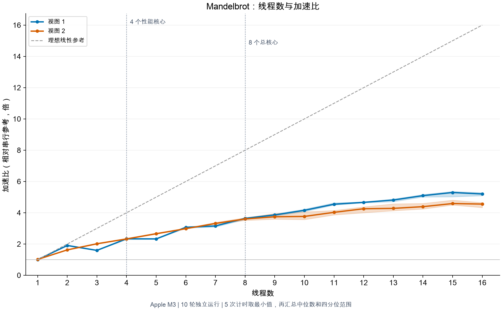
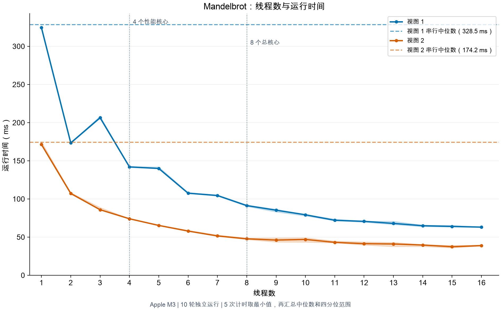
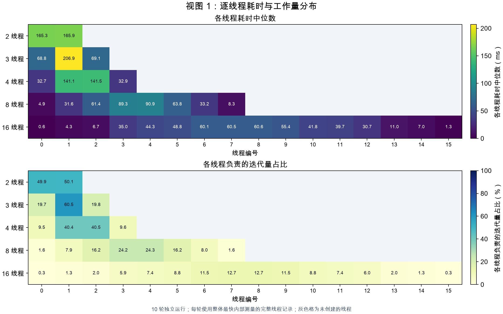
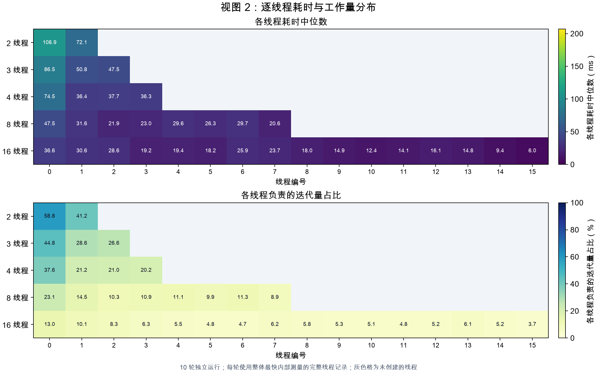
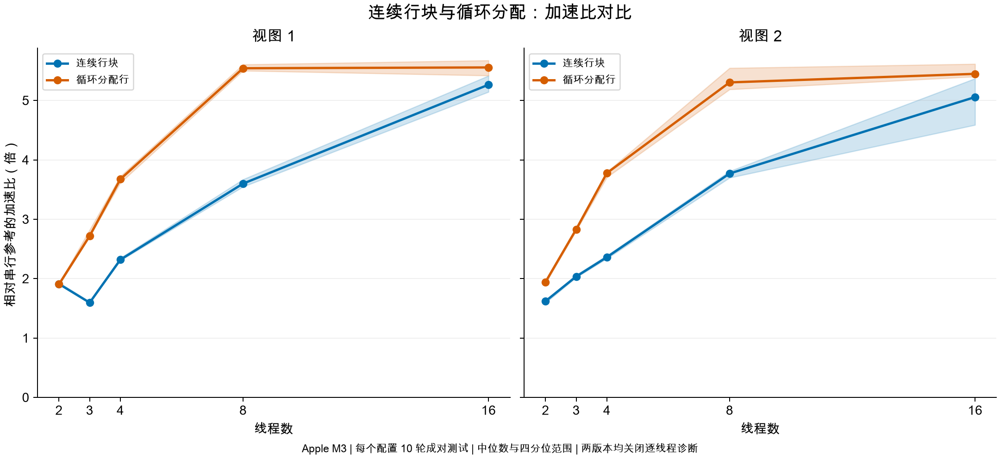
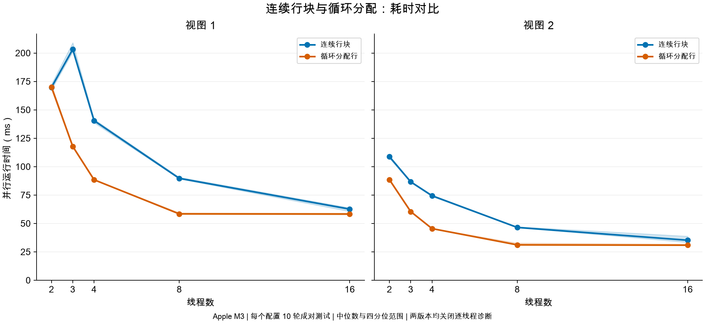
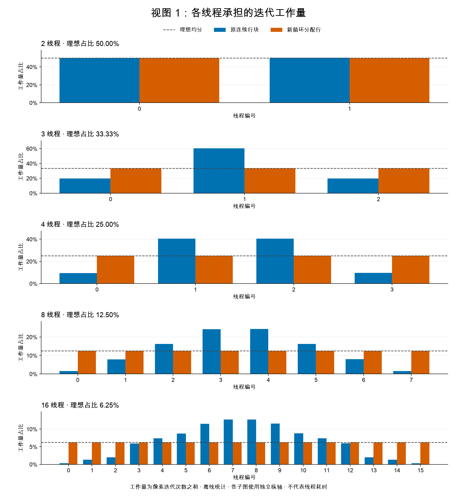
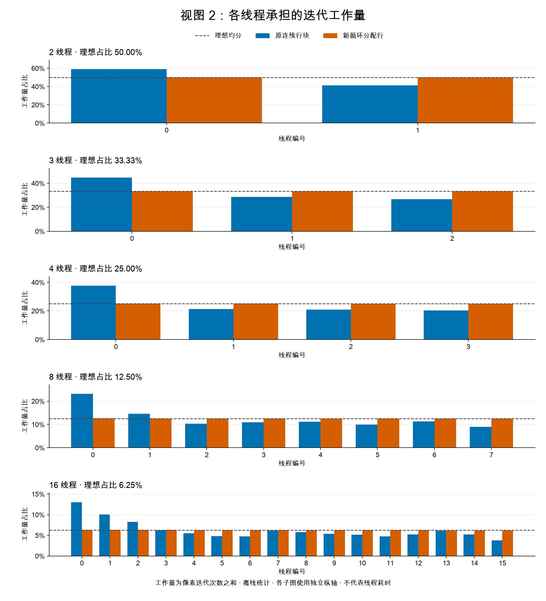

# Problem 1：线程并行、负载分析与优化

本报告整理 Apple M3 上完成的五个问题：先按连续行块分配工作，观察线程数与加速比，再用逐线程计时验证负载不均，最后改为循环分配行并比较优化效果。三轮正式实验全部通过程序内置结果校验；图表与数据均来自已完成的实验，本次整理没有重跑测速。

## 实验环境与测量方法

- 机器：Apple M3，4 个性能核心、4 个能效核心，8 个物理／逻辑 CPU，16 GiB 内存；macOS 26.5.2，原生 ARM64。
- 编译：Apple Clang 16.0.0；`-I../common -Iobjs/ -O3 -std=c++11 -Wall -fPIC`。
- 输入：1600 × 1200 像素，两种视图，最多 256 次迭代。
- 每次启动内部串行、并行各执行 5 次，分别取最短时间；同次启动的串行最短时间除以并行最短时间得到加速比。每个配置独立运行 10 轮，报告加速比中位数与第 25、75 百分位。
- 使用种子 7 打散配置，顺序运行；每个视图先以 1 线程预热一次，不计入正式数据。对照实验对每个版本分别预热，同一配置的新旧版本相邻运行，先后顺序也随机。
- 并行计时包含线程创建、计算与 join；图像写入、清零、结果校验、工作量统计和诊断打印在计时区间之外。逐线程诊断实验的时钟读取与记录写入在计时区间内。
- 实验时接通电源，记录中的低电量模式为关闭；没有固定线程到某类核心，也未自动修改系统设置。
- 四分位范围表示样本波动，不是置信区间。跨阶段实验包含测量时刻及诊断开销差异；评价算法优化优先使用第三轮的新旧配对对照。

| 阶段 | 正式运行时间（2026-10-14，UTC+8） | 配置 | 正式运行数 | 逐线程计时 |
| --- | --- | --- | ---: | --- |
| 初始连续分块 | 10:50–11:01 | 两个视图 × 1–16 线程 × 10 轮 | 320 | 关闭 |
| 连续分块诊断 | 11:25–11:29 | 两个视图 × 2、3、4、8、16 线程 × 10 轮 | 100 | 开启 |
| 新旧算法对照 | 12:08–12:15 | 两种算法 × 两个视图 × 2、3、4、8、16 线程 × 10 轮 | 200 | 两者均关闭 |

详细环境、源码提交及快照哈希、原始目录和图表来源见 [experiments.json](experiments.json)。实验时存在未提交改动，不能仅用 HEAD 提交号代表实际测量源码。

## 第一部分：两线程空间分解

最初实现让线程 0 处理上半图、线程 1 处理下半图。主线程作为线程 0 参与计算，另外创建一个工作线程，最后通过 join 等待完成。两者写入互不重叠的输出行，无需在计算过程中同步。两个视图均通过串行参考结果校验。之后将该策略推广为连续行块；当前代码则使用第四部分的循环分配策略。

## 第二部分：线程数与加速比

初始算法将高度按线程数划分为连续行块，并把余数行交给最后一个线程。曲线没有随线程数线性增长，View 1 的 3 线程甚至比 2 线程更慢。





| 线程数 | View 1 加速比 | View 1 并行耗时（ms） | View 2 加速比 | View 2 并行耗时（ms） |
| ---: | ---: | ---: | ---: | ---: |
| 1 | 1.003× | 324.514 | 1.013× | 171.443 |
| 2 | 1.904× | 173.457 | 1.624× | 107.250 |
| 3 | 1.593× | 206.452 | 2.016× | 85.893 |
| 4 | 2.336× | 142.051 | 2.326× | 74.067 |
| 5 | 2.327× | 139.963 | 2.657× | 65.310 |
| 6 | 3.070× | 107.546 | 2.983× | 57.970 |
| 7 | 3.156× | 104.516 | 3.315× | 51.553 |
| 8 | 3.643× | 91.350 | 3.604× | 47.806 |
| 9 | 3.860× | 85.263 | 3.742× | 46.142 |
| 10 | 4.155× | 79.292 | 3.764× | 46.974 |
| 11 | 4.546× | 72.054 | 4.026× | 43.146 |
| 12 | 4.665× | 70.686 | 4.255× | 41.448 |
| 13 | 4.813× | 67.964 | 4.279× | 41.016 |
| 14 | 5.094× | 64.951 | 4.389× | 39.633 |
| 15 | 5.295× | 64.001 | 4.588× | 37.424 |
| 16 | 5.201× | 63.107 | 4.555× | 38.914 |

完整中位数与四分位数见 [baseline_summary.csv](data/baseline_summary.csv)。

**初始假设：**每行像素数相同，但像素迭代次数不同。View 1 的复杂区域集中于中部，3 线程的中间行块可能承担更多计算；其他线程结束后，整个程序仍需等待最慢线程。异构核心、频率和调度开销也可能影响曲线，但仅凭这条曲线无法确定具体原因。

## 第三部分：逐线程计时验证

在原连续分块实现的 workerThreadStart 开始与计算结束处读取时钟。各线程只写自己的记录，不在线程内部打印，不新增屏障或锁。保存每次启动的 5 套记录，并选取整体并行耗时最短的一套完整线程记录进行汇总；不分别挑选各线程的最快时间。此次诊断保留了 3300 条原始记录与 660 条选中记录，本精选目录只收录 66 条逐线程汇总及配置不均衡度。

工作量定义为线程负责区域内所有像素的迭代次数之和。工作量不均衡度 = 最大线程迭代量 / 平均线程迭代量；耗时不均衡度同样取最大耗时 / 平均耗时，再跨轮汇总；1 表示完全均衡。





### 3 线程的关键证据

| 视图 | 线程编号 | 行范围 | 耗时中位数（ms） | 耗时 Q25–Q75（ms） | 迭代量占比 |
| ---: | ---: | --- | ---: | ---: | ---: |
| 1 | 0 | [0, 400) | 68.823 | 68.682–69.004 | 19.72% |
| 1 | 1 | [400, 800) | 206.866 | 200.955–209.789 | 60.45% |
| 1 | 2 | [800, 1200) | 69.080 | 69.047–69.182 | 19.83% |
| 2 | 0 | [0, 400) | 86.523 | 84.541–86.995 | 44.80% |
| 2 | 1 | [400, 800) | 50.835 | 50.716–51.021 | 28.60% |
| 2 | 2 | [800, 1200) | 47.529 | 47.368–47.831 | 26.60% |

**实测结论：**View 1 的线程 1 承担约 60.45% 迭代量，耗时约 206.9 ms；另外两个线程各承担约 19.7%–19.8%，耗时约 69 ms。最重线程同时也是慢线程，支持连续分块的负载不均导致 3 线程性能倒退的解释。View 2 的最重线程占约 44.80%，不均衡程度较小，3 线程没有出现同样的性能倒退。

| 视图 | 线程数 | 耗时不均衡度中位数 | 工作量不均衡度 |
| ---: | ---: | ---: | ---: |
| 1 | 2 | 1.002 | 1.002 |
| 1 | 3 | 1.798 | 1.814 |
| 1 | 4 | 1.620 | 1.620 |
| 1 | 8 | 1.897 | 1.943 |
| 1 | 16 | 1.995 | 2.039 |
| 2 | 2 | 1.203 | 1.177 |
| 2 | 3 | 1.400 | 1.344 |
| 2 | 4 | 1.610 | 1.505 |
| 2 | 8 | 1.675 | 1.847 |
| 2 | 16 | 1.967 | 2.085 |

数据见 [thread_summary.csv](data/thread_summary.csv) 与 [imbalance_summary.csv](data/imbalance_summary.csv)。

线程耗时是墙钟时间，包含被系统暂停或抢占的时间，不能据此确定线程运行在哪类核心上。像素迭代数只是工作量代理指标，不能完全解释分支、访存和调度等执行成本。

## 第四部分：循环分配行优化

新策略让编号为 t 的线程处理 t、t + N、t + 2N 等行，其中 N 为线程数：

```cpp
for (int row = threadId; row < height; row += numThreads) {
    mandelbrotSerial(x0, y0, x1, y1, width, height,
                     row, 1, maxIterations, output);
}
```

复杂区域的行被分散到各线程，避免一个线程独占图像中部。同一条规则适用于所有线程数，没有按配置硬编码；每行恰好由一个线程计算，计算过程中无需线程间通信或额外同步。

为公平比较，将原算法与新算法的源码快照分别构建，使用相同 Clang/C++11/-O3 参数，两者都关闭逐线程诊断。同一配置的新旧版本相邻执行，每个版本每个配置 10 轮。





| 视图 | 线程数 | 原耗时（ms） | 新耗时（ms） | 原加速比 | 新加速比 | 配对性能提升中位数 |
| ---: | ---: | ---: | ---: | ---: | ---: | ---: |
| 1 | 2 | 169.827 | 170.036 | 1.911× | 1.905× | 1.000× |
| 1 | 3 | 203.301 | 117.766 | 1.595× | 2.719× | 1.727× |
| 1 | 4 | 140.482 | 88.447 | 2.319× | 3.674× | 1.579× |
| 1 | 8 | 89.702 | 58.410 | 3.600× | 5.542× | 1.547× |
| 1 | 16 | 62.612 | 58.314 | 5.265× | 5.556× | 1.072× |
| 2 | 2 | 108.810 | 88.521 | 1.620× | 1.943× | 1.232× |
| 2 | 3 | 86.641 | 60.429 | 2.036× | 2.830× | 1.433× |
| 2 | 4 | 74.419 | 45.460 | 2.361× | 3.778× | 1.637× |
| 2 | 8 | 46.488 | 31.147 | 3.770× | 5.304× | 1.478× |
| 2 | 16 | 35.231 | 30.869 | 5.057× | 5.448× | 1.121× |

配对性能提升先对每一对运行计算“原并行耗时 / 新并行耗时”，再取中位数，因此不必等于表中两个耗时中位数的比值。数据与提升四分位数见 [comparison.csv](data/comparison.csv)。

**实测结论：**View 1 的 3 线程耗时从约 203.3 ms 降至 117.8 ms，配对耗时下降中位数约 42.1%，加速比从 1.59× 提高到 2.72×；3 线程比 2 线程更慢的异常已消除。最终 8 线程加速比分别为 **View 1：5.54×，View 2：5.30×**。

按 [ARM 版作业说明](../../README_aarch64.md)，优化目标是在本机上尽量提高性能。Intel 版的约 7–8×目标针对另一种硬件配置，不作为本次 M3 实验的验收要求。

### 新旧算法的工作量分配

测速完成后，单独用同一份串行参考函数计算每行迭代量，再按两种行分配方式汇总到线程。View 1 总迭代量为 133154262，View 2 为 76760677，均与原诊断实验的参考总数一致。**新算法没有采集逐线程运行时间；以下是离线计算的迭代工作量。**





蓝色为原连续分块，橙色为新循环分配，虚线为理想均分；各子图纵轴独立。新算法在全部测试配置下均接近均分，最重线程超过平均工作量的幅度不到 1%。这说明迭代工作量更均衡，不能等同于各线程实际耗时相同。

## 第五部分：增加线程是否继续改善性能

下面使用同一轮对照实验中新算法的数据：

| 视图 | 4 线程加速比／耗时 | 8 线程加速比／耗时 | 16 线程加速比／耗时 |
| ---: | ---: | ---: | ---: |
| 1 | 3.674× / 88.447 ms | 5.542× / 58.410 ms | 5.556× / 58.314 ms |
| 2 | 3.778× / 45.460 ms | 5.304× / 31.147 ms | 5.448× / 30.869 ms |

**实测结论：**从 4 增加到 8 线程，两种视图仍有明显收益；从 8 增加到 16 线程，收益很小。
View 1 按并行耗时中位数计算仅下降约 0.16%。
View 2 按并行耗时中位数计算仅下降约 0.89%。
结合曲线的四分位波动，16 线程的较高加速比中位数不能视为稳定显著的性能优势。

**原因假设：**8 线程时迭代工作量已接近均衡，再增加线程不会增加物理核心。M3 的性能核心与能效核心能力不同，线程创建、调度以及频率变化也可能限制收益。本机记录为 8 个物理核心和 8 个逻辑 CPU，没有 SMT；不能用超线程解释 16 线程表现。这些解释与实测相容，但本次没有核心调度或频率追踪，不能断言各线程具体使用哪类核心。

ARM 版说明按性能核心数及其两倍比较，本机对应 4 与 8 线程；原版的 8 与 16 线程比较也已覆盖。

## 附录：全部已统计配置的逐线程工作量占比

覆盖本次新旧对照的全部线程数：2、3、4、8、16。线程编号从 0 开始。占比按整张图的迭代总数归一化；以下百分比四舍五入后可能不严格加总为 100%。精确迭代量、行数及占比见 [workload.csv](data/workload.csv)。

### View 1

#### 2 线程

| 线程编号 | 原连续分块 | 新循环分配 | 理想均分 |
| ---: | ---: | ---: | ---: |
| 0 | 49.9080% | 50.0001% | 50.0000% |
| 1 | 50.0920% | 49.9999% | 50.0000% |

#### 3 线程

| 线程编号 | 原连续分块 | 新循环分配 | 理想均分 |
| ---: | ---: | ---: | ---: |
| 0 | 19.7170% | 33.3450% | 33.3333% |
| 1 | 60.4537% | 33.3273% | 33.3333% |
| 2 | 19.8293% | 33.3277% | 33.3333% |

#### 4 线程

| 线程编号 | 原连续分块 | 新循环分配 | 理想均分 |
| ---: | ---: | ---: | ---: |
| 0 | 9.5044% | 24.9931% | 25.0000% |
| 1 | 40.4036% | 25.0007% | 25.0000% |
| 2 | 40.5007% | 25.0069% | 25.0000% |
| 3 | 9.5913% | 24.9992% | 25.0000% |

#### 8 线程

| 线程编号 | 原连续分块 | 新循环分配 | 理想均分 |
| ---: | ---: | ---: | ---: |
| 0 | 1.5998% | 12.4990% | 12.5000% |
| 1 | 7.9045% | 12.4953% | 12.5000% |
| 2 | 16.1664% | 12.5033% | 12.5000% |
| 3 | 24.2372% | 12.5041% | 12.5000% |
| 4 | 24.2893% | 12.4941% | 12.5000% |
| 5 | 16.2114% | 12.5055% | 12.5000% |
| 6 | 7.9688% | 12.5036% | 12.5000% |
| 7 | 1.6226% | 12.4950% | 12.5000% |

#### 16 线程

| 线程编号 | 原连续分块 | 新循环分配 | 理想均分 |
| ---: | ---: | ---: | ---: |
| 0 | 0.2835% | 6.2331% | 6.2500% |
| 1 | 1.3164% | 6.2364% | 6.2500% |
| 2 | 1.9715% | 6.2486% | 6.2500% |
| 3 | 5.9330% | 6.2491% | 6.2500% |
| 4 | 7.3952% | 6.2469% | 6.2500% |
| 5 | 8.7712% | 6.2560% | 6.2500% |
| 6 | 11.5211% | 6.2550% | 6.2500% |
| 7 | 12.7161% | 6.2587% | 6.2500% |
| 8 | 12.7420% | 6.2659% | 6.2500% |
| 9 | 11.5474% | 6.2589% | 6.2500% |
| 10 | 8.8011% | 6.2547% | 6.2500% |
| 11 | 7.4102% | 6.2551% | 6.2500% |
| 12 | 5.9717% | 6.2472% | 6.2500% |
| 13 | 1.9971% | 6.2495% | 6.2500% |
| 14 | 1.3337% | 6.2486% | 6.2500% |
| 15 | 0.2889% | 6.2363% | 6.2500% |

### View 2

#### 2 线程

| 线程编号 | 原连续分块 | 新循环分配 | 理想均分 |
| ---: | ---: | ---: | ---: |
| 0 | 58.8262% | 50.0338% | 50.0000% |
| 1 | 41.1738% | 49.9662% | 50.0000% |

#### 3 线程

| 线程编号 | 原连续分块 | 新循环分配 | 理想均分 |
| ---: | ---: | ---: | ---: |
| 0 | 44.8015% | 33.3730% | 33.3333% |
| 1 | 28.6012% | 33.3368% | 33.3333% |
| 2 | 26.5973% | 33.2902% | 33.3333% |

#### 4 线程

| 线程编号 | 原连续分块 | 新循环分配 | 理想均分 |
| ---: | ---: | ---: | ---: |
| 0 | 37.6204% | 25.0607% | 25.0000% |
| 1 | 21.2058% | 25.0077% | 25.0000% |
| 2 | 20.9736% | 24.9730% | 25.0000% |
| 3 | 20.2003% | 24.9586% | 25.0000% |

#### 8 线程

| 线程编号 | 原连续分块 | 新循环分配 | 理想均分 |
| ---: | ---: | ---: | ---: |
| 0 | 23.0821% | 12.5644% | 12.5000% |
| 1 | 14.5382% | 12.5424% | 12.5000% |
| 2 | 10.2761% | 12.5229% | 12.5000% |
| 3 | 10.9297% | 12.5149% | 12.5000% |
| 4 | 11.1029% | 12.4964% | 12.5000% |
| 5 | 9.8706% | 12.4653% | 12.5000% |
| 6 | 11.2779% | 12.4502% | 12.5000% |
| 7 | 8.9224% | 12.4437% | 12.5000% |

#### 16 线程

| 线程编号 | 原连续分块 | 新循环分配 | 理想均分 |
| ---: | ---: | ---: | ---: |
| 0 | 13.0294% | 6.3080% | 6.2500% |
| 1 | 10.0527% | 6.2975% | 6.2500% |
| 2 | 8.2671% | 6.2861% | 6.2500% |
| 3 | 6.2712% | 6.2855% | 6.2500% |
| 4 | 5.4986% | 6.2756% | 6.2500% |
| 5 | 4.7775% | 6.2587% | 6.2500% |
| 6 | 4.7424% | 6.2596% | 6.2500% |
| 7 | 6.1873% | 6.2596% | 6.2500% |
| 8 | 5.7645% | 6.2563% | 6.2500% |
| 9 | 5.3384% | 6.2448% | 6.2500% |
| 10 | 5.1148% | 6.2367% | 6.2500% |
| 11 | 4.7558% | 6.2294% | 6.2500% |
| 12 | 5.1798% | 6.2207% | 6.2500% |
| 13 | 6.0981% | 6.2066% | 6.2500% |
| 14 | 5.1840% | 6.1906% | 6.2500% |
| 15 | 3.7384% | 6.1840% | 6.2500% |

## 文件与追溯

本目录保留一份综合报告、8 张 PNG 图、5 份汇总 CSV 和一份精简环境记录。原始目录保留完整日志、原始测量明细、PDF、源码快照及复现实验脚本；本目录不重复收录。

| 内容 | 文件 |
| --- | --- |
| 完整线程数汇总 | [baseline_summary.csv](data/baseline_summary.csv) |
| 原算法逐线程汇总 | [thread_summary.csv](data/thread_summary.csv) |
| 原算法不均衡度 | [imbalance_summary.csv](data/imbalance_summary.csv) |
| 新旧算法性能对比 | [comparison.csv](data/comparison.csv) |
| 新旧逐线程工作量 | [workload.csv](data/workload.csv) |
| 环境与文件来源 | [experiments.json](experiments.json) |

原始实验目录（相对仓库根目录）：

- `baseline`：`results/problem1/20261014-105022-563071/`。
- `diagnostics`：`results/problem1/20261014-112552-293879/`。
- `comparison`：`results/problem1/20261014-120611-275628-comparison/`。

这些原始目录由 Git 忽略，仅在当前本地工作区提供追溯；精选目录可以纳入 Git。统计方法和阶段说明已写入本报告，因此阅读精选结果不依赖原始目录。

当前优化源码关闭了逐线程计时实现，保留的原连续分块诊断来自历史源码快照。若要重新采集优化版逐线程时间，需要先适配循环行分配的诊断记录与校验；不能直接把当前 --thread-timing 输出当作有效测量。
