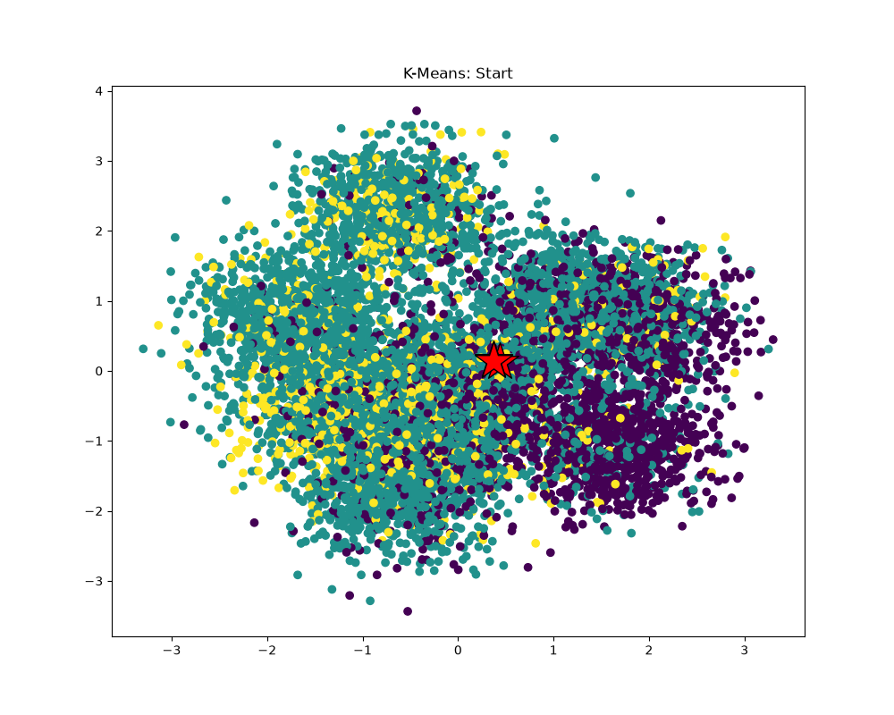
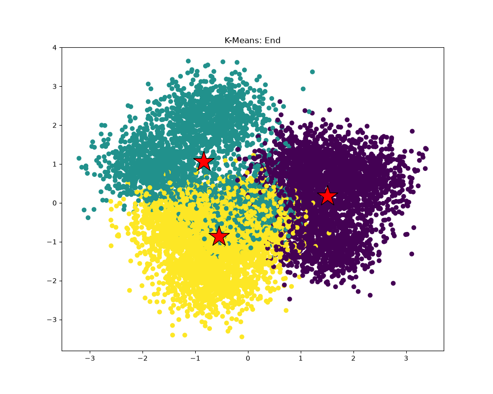

# Problem 6：K-Means 热点定位与并行优化

本文回答 [ARM 版作业说明](../README_aarch64.md#program-6-making-k-means-faster-15-points)中的四项要求，并记录当前 Apple M3 上的实现与实验。

当前代码是本地扩展练习：三个计算阶段都使用线程，Assignments 还使用 ISPC。它超出了课程“只修改 `kmeansThread.cpp`、只并行一个指定函数”的限制。最初只并行 `computeAssignments` 的版本另有测量记录，达到约 **2.43×** 整体加速；不能把当前扩展版本当作符合该限制的课程提交。

## 1. 数据、构建与运行

使用本地已有的 `data.dat`，没有重新生成数据，也不需要 Stanford 账号。数据头为 `M=1000000`、`N=100`、`K=3`、`epsilon=0.1`，文件大小为 804002420 字节。距离与中心坐标均使用双精度。

在仓库根目录执行：

```sh
make -j4 -C prog6_kmeans
cd prog6_kmeans
./kmeans
```

程序按当前工作目录读取 `data.dat`，生成 `start.log`、`end.log`，打印迭代次数、三个阶段的累计耗时和整体耗时。每个阶段外使用 `CycleTimer::currentSeconds()`；计时包含线程创建、计算、等待与归约。全部迭代结束后才打印，避免把逐次终端输出计入计算。

`[Total Time]` 计量 `kMeansThread()` 调用，包含函数内部的分配与计时输出；不包含读取数据和在函数外生成两份采样日志的时间。它与外部命令的墙钟耗时不是同一指标。

## 2. 绘图与正确性

根目录的 Python 虚拟环境已配置适配本机的依赖，保留原课程 `requirements.txt`。在 `prog6_kmeans` 中执行：

```sh
../.venv/bin/python plot.py
```

生成的图片为 `start.png` 和 `end.png`。下图由当前版本的日志通过原 `plot.py` 生成：





这些图将 100 维数据通过 PCA 投影到二维，点的颜色表示簇编号，红色星形表示中心。二维投影不保持所有高维距离关系，所以不能要求每个点在图上都最靠近其所属簇的星形。程序日志仅采样部分数据，图片用于观察结构，完整数组比较才是本次主要的正确性检查。

原始版、仅并行 Assignments 的版本及当前版本均收敛 **50 次**。对完整数据集比较最终结果，当前版全部 100 万个点的簇编号与原始版一致。相对于此前结果完全一致的 Assignments-only 版本，当前版中心坐标最大绝对差约为 `3.04e-14`，各簇 cost 最大相对差约为 `2.45e-14`。这些差异来自归约改变了浮点加法顺序，不能声称任意输入都逐位相同；极接近分类或收敛边界的其他输入仍可能受舍入影响。

另有 36 组阶段测试覆盖空输入、数据点少于线程数、余数分块、不同维数、空簇、cost 输出子区间和数组边界哨兵，优化构建和 UBSan 均通过。Assignments 此前还检查了等距中心时选择较小编号的行为。ASan 在本机运行库初始化时失败，本次未获得 ASan 检查结论。

## 3. 时间主要花在哪里

先只给原串行版本添加阶段计时，不改变算法。第一轮对同一数据各独立运行 5 次，阶段累计耗时的中位数如下：

| 阶段 | 累计耗时中位数（ms） | 每轮主要工作 |
| --- | ---: | --- |
| `computeAssignments` | 8160.297 | 每个点与 K 个中心分别计算 N 维距离，O(MKN) |
| `computeCentroids` | 816.521 | 按簇累加所有坐标并求均值，O(MN + KN) |
| `computeCost` | 2117.465 | 每个点与所属中心计算一次距离并累加，O(MN) |
| 整体 | 11153.957 | 完整 50 次迭代 |

**最初的热点是 `computeAssignments`，约占整体耗时的 73%。**这里 M 为一百万，而 K 仅为 3、N 为 100，因此优先并行数据点，能产生足够粗的工作块；只按 3 个簇切分，可用并行度较小。

若假设热点比例 p 固定、只有该部分获得 S 倍提升，Amdahl 模型为 `1 / ((1-p) + p/S)`。用 `p≈0.73` 估算，四线程仅靠理想分摊约为 2.21×，无限加速该部分的参考上限约为 3.70×。实际优化还调整了循环和访存，这个简化模型不能直接当作所有改动后的上限。

## 4. 优化过程、最终实现与收益

### 4.1 先调整 Assignments 的循环，再并行数据点

原实现外层遍历中心、内层遍历点，并维护长度为 M 的 `minDist` 数组。改成外层遍历点，每个点按原顺序遍历所有中心，用局部最小距离和最佳编号代替临时数组。保留初值 `1e30`、编号 `-1`、严格 `<` 比较和原 `dist()`，等距时仍选择较小编号。

随后将 M 个点划为连续、不重叠的区间，创建 T−1 个工作线程，主线程处理一块，全部 join 后才更新中心。线程共享只读数据与中心，各自只写负责的 assignments，无需锁。

第一轮各配置 5 次，整体耗时为：

| 配置 | 整体中位数（ms） | 相对该轮原始版加速比 |
| --- | ---: | ---: |
| 原始串行 | 11153.957 | 1.00× |
| 调整循环，1 线程 | 8870.318 | 1.26× |
| 调整循环，2 线程 | 6222.199 | 1.79× |
| 调整循环，4 线程 | 4593.706 | **2.43×** |
| 调整循环，8 线程 | 4601.837 | 2.42× |

单线程改写本身约改善 1.26×；改写后的单线程到四线程，整体再改善约 1.93×。四线程和八线程整体耗时很接近，故保留四线程。**仅改写并并行 Assignments 的这一阶段已经超过题目的约 2.1× 目标**，且没有并行其他函数。

### 4.2 对距离累加尝试多累加器与 ISPC

距离内层的顺序累加存在依赖链。在临时副本中尝试 C++ 双／四累加器，以及用 ISPC `foreach` 沿维度累加、最后 `reduce_add()`。各配置仍用 4 个 C++ 线程处理数据点，Cost 阶段保留原 `dist()`。第二轮各运行 5 次：

| Assignments 距离实现 | Assignments 中位数（ms） | 整体中位数（ms） |
| --- | ---: | ---: |
| 原顺序累加 | 1610.514 | 4419.125 |
| C++ 双累加器 | 1159.703 | 3937.108 |
| C++ 四累加器 | 929.267 | 3752.086 |
| ISPC x4 | **628.141** | **3432.878** |
| ISPC x8 | 748.194 | 3815.215 |

选择 ISPC x4。每个线程每次迭代只跨一次 C++/ISPC 接口，批量处理整个点区间，避免每次算距离都产生调用边界开销。ISPC 使用双精度、保留平方根，关闭 FMA；归约会改变加法顺序。x4 是逻辑 gang 宽度，不能据此推导四倍的实际加速，也不能认为 x8 必然更快。

### 4.3 热点转移后，再并行 Centroids 与 Cost

Assignments 加速后，原本串行的 Cost 成为更大的剩余开销。按本地扩展练习的目标继续优化：

- `computeCentroids`：各线程按点区间累加自己的 K×N 坐标和、K 个点数，join 后按线程编号归约，再除以簇大小。空簇仍输出零中心。
- `computeCost`：各线程使用原 `dist()` 累加自己的 K 个 cost，join 后按固定顺序归约，只写 `start..end` 指定的输出区间。

不对每个点加锁，也不让多个线程同时修改同一个中心或 cost。Centroids 辅助存储为 O(TKN)，Cost 为 O(TK)，对本数据的 K=3、N=100 很小。固定归约顺序避免结果随线程完成先后变化，但不恢复原串行的加法顺序。三个阶段依次执行，每一阶段结束都会 join；不是同时启动三组线程。

第三轮各配置 5 次，Assignments 始终保持 ISPC x4、4 线程：

| Centroids / Cost 配置 | Centroids 中位数（ms） | Cost 中位数（ms） | 整体中位数（ms） |
| --- | ---: | ---: | ---: |
| 均串行 | 828.588 | 2093.079 | 3696.392 |
| 均用 4 线程 | 607.984 | 630.519 | **1911.412** |
| 均用 8 线程 | 604.833 | 670.203 | 2003.693 |

相对本轮 Assignments-only 版本，四线程扩展版整体再加速约 **1.93×**。因此当前三个阶段各用最多四个线程，数据点较少时减少线程数。更高线程数没有进一步改善整体中位数，不能仅凭这些曲线判断线程实际跑在哪类核心上。

### 4.4 原始版与当前版的同期确认

最后重新在同一轮实验中比较原始串行版与当前代码，避免直接相除上述不同时刻的实验结果。每个版本先预热一次，再以种子 7 在每轮打乱两个版本的顺序，各正式运行 5 次。原始版只增加了与当前版相同的阶段计时，没有改计算逻辑。

| 实现 | Assignments 中位数（ms） | Centroids 中位数（ms） | Cost 中位数（ms） | 整体中位数（ms） | 整体 Q25–Q75（ms） |
| --- | ---: | ---: | ---: | ---: | ---: |
| 原始串行版 | 7916.297 | 848.565 | 2029.478 | 10807.227 | 10780.086–10822.242 |
| 当前扩展版 | 703.664 | 627.561 | 675.012 | **2006.252** | 1821.957–2098.684 |

**最终整体加速比为 `10807.227 / 2006.252 ≈ 5.39×`。**这是原始实现到当前全部优化的收益；上一节的 1.93× 是只针对追加 Centroids / Cost 并行化的收益，两者基线不同。当前版不是“仅把串行代码开四个线程”，还包含循环调整和 ISPC 归约，因此不能把 5.39× 误读为纯四线程扩展比。

加速后 Centroids 的剩余时间相对较高。它的每坐标算术量较少，需要扫描完整数据，内存吞吐可能限制进一步扩展；线程启动、归约、系统调度也会消耗时间。没有硬件计数器或核心追踪数据，这些是解释方向，不能据此断言已经达到内存带宽上限或确认使用了哪些核心。

## 测量口径与数据

历史三轮均每配置运行 5 次、种子 7 打乱配置、逐个运行，不把不同轮次中位数的比值当作同期对照。各阶段中位数相加不一定等于整体中位数，因为它们分别独立统计。

历史数据见 [线程实验](results/assignments_threads_summary.csv)、[SIMD 实验](results/assignments_simd_summary.csv)、[三阶段实验](results/all_stages_summary.csv)。环境、源码哈希与数据集标识记录在 [experiments.json](results/experiments.json)。

最终同期确认的 [逐次数据](results/comparison_raw.csv)、[汇总数据](results/comparison_summary.csv)及[构建、预热与正式运行日志](results/logs/)一并保留。机器为 Apple M3（4 个性能核心、4 个能效核心，16 GiB 内存）；使用 Apple Clang 16.0.0、ISPC 1.31.0。C++ 参数为 `-O3 -std=c++11 -Wall`，ISPC 参数为 `-O3 --target=neon-i32x4 --arch=aarch64 --pic --opt=disable-fma`，另含 Makefile 中的头文件路径与链接选项。线程未绑定核心，未修改 QoS 或系统设置。

数据均为本机当前数据集的实测，五次样本用于描述中位数和波动范围，没有做显著性检验，也不能代表其他 Mac、Intel 课程机器或任意输入上的保证。
